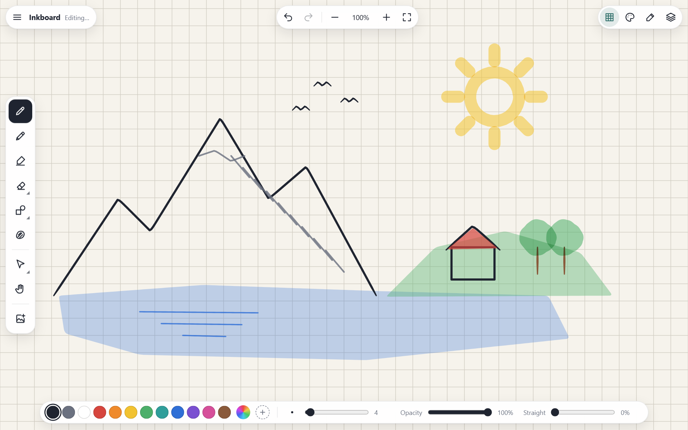
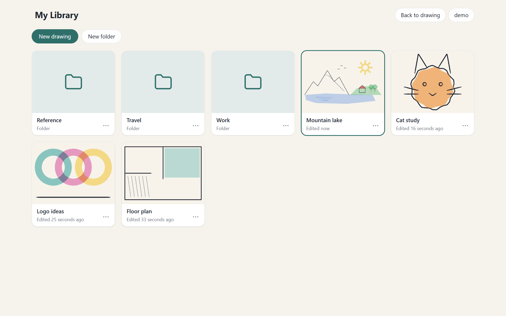
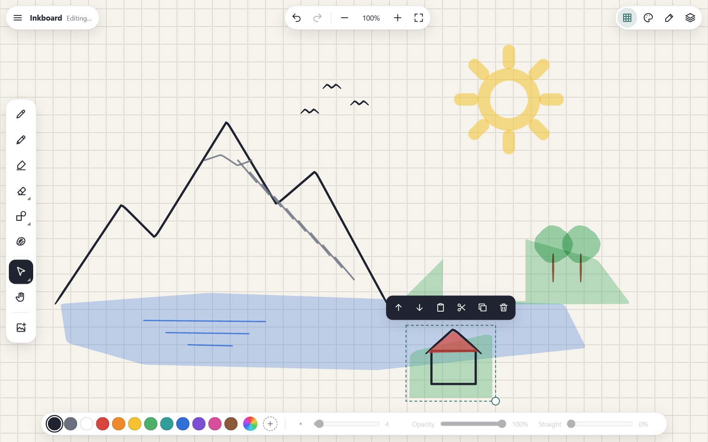
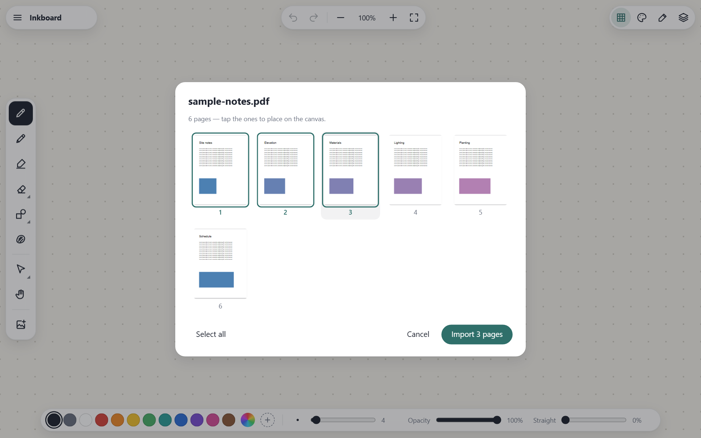

# Inkboard

A self-hosted sketching app for the browser, inspired by infinite-canvas apps like Concepts. Plain HTML/CSS/JS — no build step, no npm dependencies (pdf.js is vendored for PDF import) — served by nginx, with a small PocketBase backend for accounts and a synced drawing library (optional: without it, the app works as a single-drawing local app).



| Your library: folders and drawings, synced across devices | Cut-through lasso: select and move part of a drawing |
|---|---|
|  |  |

| Import PDF pages |
|---|
|  |

## Features

- **Infinite canvas** — pan (two fingers, Space+drag, middle mouse, hand tool), pinch / Ctrl+wheel zoom, fit-to-drawing
- **Brushes** — pressure-sensitive pen, pencil, and multiply-blended marker; Apple Pencil and other styluses supported
- **Stylus-only mode** — auto-enables when a pen is detected, so palms and fingers only pan/zoom
- **Straight lines** — per-brush *Straight* slider (0% freehand → 100% ruler-straight), hold still mid-stroke to snap, or hold Shift
- **Shapes** — line, rectangle, ellipse (Shift for 15° angles, squares, circles)
- **Fill** — draw any outline and it becomes a filled shape (uses the colour and opacity slider)
- **Eraser** — erases just the part of a stroke you rub over, and removes a fill when you rub on it (ink drawn on top of a fill is erased without deleting the fill). Tap the eraser again for *whole* mode, which removes entire strokes. Images and PDF pages are never erased; select them and press Delete, or lasso part of one and delete that part
- **Select** — tap, lasso or rectangle (tap the select tool again for options). By default the selection *cuts through* objects: lasso part of a stroke, image, PDF page or fill and only that part is selected (switch to *whole objects* in the options); move, scale from the corner handle, copy / cut / paste (Ctrl+C/X/V, or tap empty canvas to paste), duplicate, delete, reorder, recolour
- **Layers** — add, duplicate, delete, reorder, rename, hide, per-layer opacity
- **Colours** — 12 built-in swatches plus your own saved colours (**+** saves the current colour; long-press or right-click one to remove)
- **Grids & paper** — dots, lines, isometric; warm, white, blueprint and slate paper
- **Undo / redo** — buttons, keyboard, two-finger tap (undo) and three-finger tap (redo)
- **Insert button** — the last button on the tool bar (or **I**) opens the picker for images and PDFs
- **Files**
  - Import PNG / JPG / WebP / GIF / SVG via menu, drag-and-drop, or paste
  - Import PDF pages (pick pages from thumbnails; they're placed as images in a column)
  - Save and open projects as `.inkb` (JSON, images embedded)
  - Export PNG (opaque or transparent), SVG (vector), PDF
  - Autosaves to your server (or, in local mode, to the browser)
- **Accounts & library** — sign in, then a library of your drawings with folders, thumbnails, rename / duplicate / move / delete; drawings sync to your server so you can continue on any device. Accounts are created by the admin (no public sign-up); each person's library is private
- **Safety net** — every save is also kept on the device; if the connection drops you keep drawing and it uploads when it's back. If the same drawing was changed on another device meanwhile, you choose: save yours as a copy, keep yours, or load theirs
- **Installable** — add to home screen; works offline once loaded over HTTPS

## Run it

```bash
mkdir -p data
docker compose up -d --build
```

Two containers start:

| Port  | What | Expose it? |
|-------|------|------------|
| 19410 | The app, plus the API under `/api/` | Yes: point your reverse proxy here, or open `http://<server-ip>:19410` on your LAN |
| 19411 | PocketBase admin UI (`/_/`), for managing accounts | **No.** LAN only. Never add it to your reverse proxy or router |

Everything the server stores (accounts, drawings, uploaded images) lives in `./data/pb_data`.

### Create the admin and your account

1. Create the PocketBase admin (superuser). This is only for the admin UI, not for drawing:

   ```bash
   docker compose exec pocketbase pb superuser upsert you@example.com 'a-long-admin-password'
   ```

2. Open `http://<server-ip>:19411/_/`, sign in as that admin, open the **users** collection and choose **New record**. Fill in **username** (lowercase letters, numbers, `.` `_` `-`) and **password**; email is optional. Repeat for everyone who should have access.

3. Open the app and sign in with that username (or email) and password.

To reset someone's password, edit their record in the admin UI. There is no public sign-up page.

### HTTPS and outside access

You need HTTPS whenever you sign in from outside your home network: passwords go over the network, and browsers only enable offline/installable mode on HTTPS. Example with Nginx Proxy Manager and a Cloudflare-managed domain:

- Add a DNS record `inkboard.example.com` in Cloudflare that points to your home server (proxied).
- In Nginx Proxy Manager add a **Proxy Host**: domain `inkboard.example.com`, forward to `http://<server-ip>:19410`, request an SSL certificate, and turn on **Force SSL**.
- Optional extra layer: put the hostname behind Cloudflare Access (Zero Trust) so only the people you allow can reach the sign-in page at all.

Using `http://<server-ip>:19410` at home also works, but the browser treats it as a different site from the HTTPS address. You'll sign in separately there, and your password crosses your Wi-Fi unencrypted. Prefer the HTTPS address everywhere.

Login attempts are rate-limited per client IP. nginx passes Cloudflare's `CF-Connecting-IP` header through to PocketBase.

### Without a backend

The app also runs as plain static files, e.g. `cd app && python3 -m http.server 8765`. With no `/api/` to talk to it switches to **local mode**: no sign-in, and a single drawing autosaved in the browser.

## Backups and restore

Back up `./data/pb_data`, for example with a nightly `rsync` to your NAS. For a consistent copy, either stop the `pocketbase` container briefly, or use the admin UI's **Settings → Backups**. Those backups can be scheduled, and they're written to `data/pb_data/backups/`, so they're included in your folder backups.

To restore: `docker compose stop pocketbase`, replace `./data/pb_data` with the backup, then `docker compose start pocketbase`.

Each user can also download any drawing as a self-contained `.inkb` file (**Menu → Download .inkb file**, images embedded) and import it again later.

## Updating

Edit files in `app/`, bump `CACHE` in `app/sw.js`, then `docker compose up -d --build`. Schema changes go in a new file in `backend/pb_migrations/`; PocketBase applies it on start.

## Project layout

```
app/                    static web app: index.html, styles.css, app.js (editor), api.js (server client),
                        library.js (sign-in + library screens), sw.js, manifest, icons
app/vendor/             third-party code, unmodified (pdf.js; see its VERSION.txt / LICENSE)
nginx/                  nginx site config (static files + /api proxy) and security headers
backend/                PocketBase image: Dockerfile, pb_migrations/ (schema), pb_hooks/ (server-side checks)
Dockerfile              nginx:alpine image for the app
docker-compose.yml      both services
docs/screenshots/       images used in this README
data/                   server data (created on first start; not in git)
```

## License

MIT. See [LICENSE](LICENSE). Bundled third-party code keeps its own license: pdf.js in `app/vendor/pdfjs/` is Apache-2.0 (see its `LICENSE`). PocketBase (MIT) is downloaded when the backend image is built.
